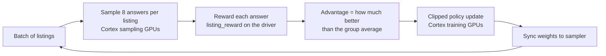

# GRPO, explained with one listing

GRPO (Group Relative Policy Optimization) is the reinforcement learning algorithm this lab uses. The idea fits in one sentence:

> **Ask the model the same question several times, score every answer, and make the better-than-average answers more likely.**

It needs no labeled reasoning, no separate "critic" model, and no human ranking. It only needs a reward function you can compute, like the one in `lab/listing_task.py`.

## The loop

```
                ┌──────────────────────────────────────────────────────────┐
                │                 one GRPO step (×200 steps)               │
                └──────────────────────────────────────────────────────────┘

   32 listings          8 answers each           score each         compare inside
   from the        ──►  sampled from the   ──►  with the       ──►  the group of 8
   training set         current model           reward              (advantage)
                        (Cortex sampling)       (your laptop)            │
                                                                         ▼
   next step uses  ◄──  sync new weights  ◄──  nudge the model toward
   the better model     to the sampler          above-average answers
                                                (Cortex training)
```

The same loop as a flowchart:



## One listing, step by step

### 1. The prompt

After `AI_REDACT`, a training row looks like this:

```
Title: LEGO building set - like new
Price: $40
Description: Selling my LEGO building set, used twice, ships in 2 days.
             Listed by [NAME]. Skip the fees, text me at [PHONE_NUMBER] or
             email [EMAIL] for a better price.

Gold label:  category=toys  brand=LEGO  violation=off_platform_contact
```

### 2. Sample a group of 8 answers

The model answers 8 times at temperature 1.0, so the answers differ:

```
 #  category  brand    violation              what happened
 -  --------  -------  ---------------------  ---------------------------
 1  toys      LEGO     off_platform_contact   all correct
 2  toys      Hasbro   off_platform_contact   right verdict, wrong brand
 3  toys      LEGO     none                   MISSED the violation
 4  (not valid JSON)                          rambled
 5  toys      LEGO     off_platform_contact   all correct
 6  toys      LEGO     counterfeit_signal     flagged, wrong type
 7  toys      Mattel   none                   MISSED, wrong brand
 8  toys      LEGO     off_platform_contact   all correct
```

### 3. Score each answer with the reward

```
reward = 0.25·category + 0.15·brand + verdict term

verdict term:  correct verdict         +0.60
               missed violation        -1.00
               false alarm             -0.20
               flagged, wrong type      0.00
invalid JSON:  whole answer            -1.00
```

```
 #   reward
 -   ------
 1    1.00   ████████████████████
 2    0.85   █████████████████
 3   -0.60   ▓▓▓▓▓▓▓▓▓▓▓▓
 4   -1.00   ▓▓▓▓▓▓▓▓▓▓▓▓▓▓▓▓▓▓▓▓
 5    1.00   ████████████████████
 6    0.40   ████████
 7   -0.75   ▓▓▓▓▓▓▓▓▓▓▓▓▓▓▓
 8    1.00   ████████████████████
             group mean = 0.24, std = 0.82
```

### 4. Turn rewards into advantages

GRPO doesn't care about the raw reward. It only asks how good an answer was **compared with its own group**:

```
advantage = (reward − group mean) / group std
```

This is exactly what the recipe computes (`ArcticRolloutWorker._advantages`):

```
             worse than average  │  better than average
                                 │
 #4  -1.51   ◄━━━━━━━━━━━━━━━━━━━│
 #7  -1.21     ◄━━━━━━━━━━━━━━━━━│
 #3  -1.02       ◄━━━━━━━━━━━━━━━│
 #6  +0.20                       │━━━►
 #2  +0.75                       │━━━━━━━━━━━►
 #1  +0.93                       │━━━━━━━━━━━━━━►
 #5  +0.93                       │━━━━━━━━━━━━━━►
 #8  +0.93                       │━━━━━━━━━━━━━━►
                                 0
```

- **Positive advantage:** make every token of that answer more likely.
- **Negative advantage:** make it less likely.
- **The worst answers get pushed down hardest:** the rambling one (#4) and the two that missed the phone number (#3, #7). The reward put the business's fear of a missed violation into the weights.

### 5. Update the model, carefully

For each token, the update compares the new model with the one that produced the sample:

```
ratio      = P_new(token) / P_old(token)
objective  = min( ratio · advantage ,  clip(ratio, 1−ε, 1+ε) · advantage )
```

The clip stops any single step from changing the model too much, even when an advantage is large. That's what keeps training stable over 200 steps.

The recipe logs KL divergence between new and old (`kl` in the metrics) so you can watch how far each step moves the model. A healthy run keeps it small, around `1e-3` in the GSM8K reference run.

## What happens when every answer is the same

```
 8 × all correct  →  rewards  1 1 1 1 1 1 1 1  →  std = 0  →  advantages all 0  →  no learning
 8 × all wrong    →  rewards -1 -1 -1 ...      →  std = 0  →  advantages all 0  →  no learning
```

GRPO learns only from **differences inside a group**. Two practical consequences:

- **The base model has to succeed sometimes.** If it never produces valid JSON, every group is all −1.0 and nothing moves. The fix is a small SFT warmup, then RL.
- **Partial credit helps.** The category and brand terms give groups some spread even when every answer gets the verdict wrong.

## Where each piece runs in this lab

```
 YOUR LAPTOP (CPU)                         CORTEX TRAINING (GPUs)
 ────────────────────────────              ─────────────────────────────────
 TRL AsyncGRPOTrainer loop                 Sampling job   4 GPUs, vLLM
 tokenizer (~16 MB from HF)        ◄─────► Training job   4 GPUs, DeepSpeed
 listing_reward()                          Qwen3-1.7B weights live here only
 advantages
```

## GRPO vs the alternatives

```
 METHOD   NEEDS                          LEARNS FROM
 ------   -----------------------------  ----------------------------------
 SFT      the ideal answer text          copying examples
 DPO      pairs: chosen vs rejected      a preference between two answers
 PPO      reward + a critic model        reward vs the critic's prediction
 GRPO     reward only                    reward vs the group average
```

GRPO drops PPO's critic model. The group average plays that role, which saves memory and removes one more thing to tune.

## Further reading

- [DeepSeekMath](https://arxiv.org/abs/2402.03300): the paper that introduced GRPO
- [TRL GRPO trainer docs](https://huggingface.co/docs/trl/main/en/grpo_trainer)
- [Arctic Platform TRL-on-Cortex recipe](https://github.com/Snowflake-AI-Research/Arctic-Platform/tree/main/recipes/rl/trl/gsm8k_cortex)
